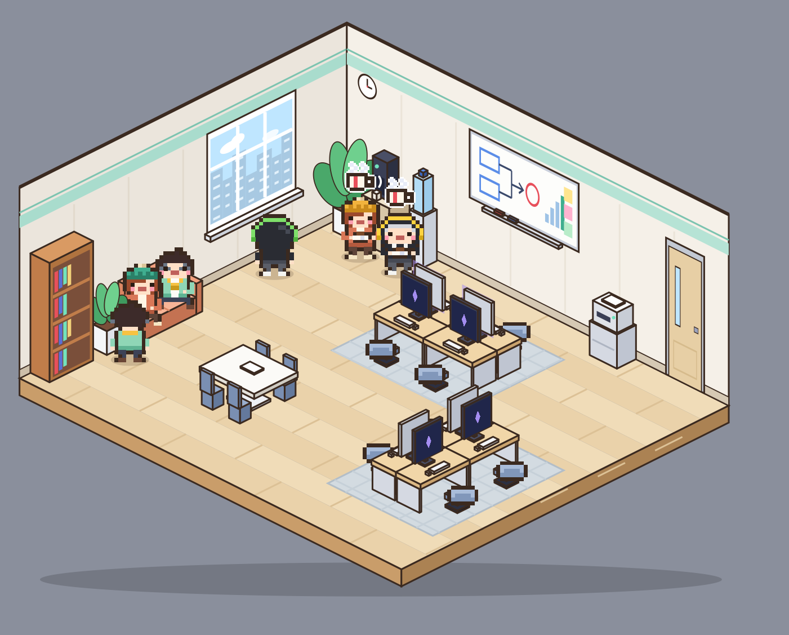
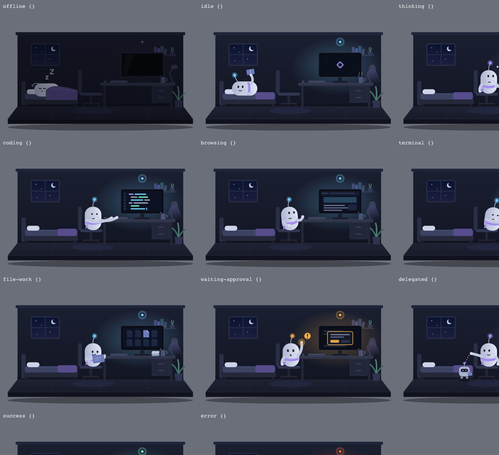

# Deskling

AI 에이전트 세션들이 실제로 일하는 모습을, 바탕화면에 박힌 작은 아이소메트릭 픽셀 **사무실**의 직원들로 보여주는 macOS 데스크톱 앱.

> **상태:** 사무실 사회(세션마다 직원 한 명), 세션 사이 대화, 사무실 성장, 활동 패널, 창 설정이 동작한다.
> **Claude Code와 Codex는 실제로 연결된다**(각자의 훅 → 앱, 동의 후 설치). Hermes 등 다른 에이전트의 실제 연결은 아직이며, 그 부분은 결정적 **데모**("사무실 하루")로 보여준다. 데모가 보이는 동안에는 항상 `DEMO` 배지가 표시된다.
> 진행 상황과 검증 기록은 [PROJECT_STATE.md](PROJECT_STATE.md)에 있다.


세션 하나가 직원 한 명이다. 일하는 세션은 자기 책상에서 모니터를 보고, 승인을 기다리면 일어나 손을 흔들고, 쉬는 세션은 라운지로 간다.

## 무엇을 하나

- **세션 = 직원:** Claude Code·Codex 등 에이전트 세션마다 직원 한 명(Claude 1, Claude 2, Codex 1, 에이전트 1 …). 비니·후드+헤드폰·안경+카디건으로 종류를, 모자·헤드폰·목걸이 색으로 번호를 구분한다.
  세션이 시작되면 문으로 들어와 빈 책상(8개)에 앉고, 끝나면 문으로 나간다. 아무도 없으면 사무실 불이 꺼진다.
- **자기 세션의 사실만 보인다:** 생각·코딩·웹 탐색·터미널·파일 작업은 책상에서(모니터에 상태 화면), 승인 대기는 일어나 손 흔들기, 오류는 머리 감싸기,
  위임은 책상 옆 도우미 봇, 완료는 잠깐 환호. **대기 중이면 라운지**(커피머신·정수기·소파·창가·화분·책장)로 가서 쉬고, 일이 오면 책상으로 돌아온다.
- **움직이는 사무실:** 쉬는 직원은 8–16초마다 다른 라운지 자리로 걸어가고, 걸음은 미끄럽게 이어진다. 앉거나 서 있는 직원은 숨쉬기·한 모금·살짝 흔들림·끄덕임 같은
  1px 남짓한 동작을 직원마다 다른 박자로 하고, 창밖 구름이 흐르고 화분 잎이 흔들린다. 동작 줄이기면 모두 멈춘다.
- **세션끼리 대화:** 한 세션이 다른 세션에 실제로 메시지를 보내면 둘이 서로 돌아보고 "…" 말풍선을 주고받는다. 받는 쪽을 모르면 보낸 쪽 머리 위에 편지가 뜬다. 내용은 절대 보이지 않는다.
- **사무실 요약 말풍선:** "3명 일하는 중 · 1명 승인 대기 · 2명 쉬는 중" / "아무도 없음". 누르면 활동 패널이 열린다. 누가 승인을 기다리거나 실패하면 그 아래 알림 줄.
- **에너지·화남(세션별):** 보고된 토큰이 예산을 소모할수록 그 직원 책상에 빈 캔이 쌓이고, 컨텍스트가 찰수록 머리 위 이모트가 땀 → 핏줄 → 김. 숫자는 패널에만.
- **사무실 성장:** 어느 세션이든 작업을 끝낼 때마다 경험치가 쌓여 포스터·책상 화분·줄 조명·라운지 러그·책장·트로피 선반이 하나씩 생긴다. 데모와 실제는 따로 저장.
- **직원마다 레벨:** 세션마다 따로 경험치(그 세션이 끝낸 작업 수)가 쌓여 레벨이 오른다(Lv2 1개, Lv3 3개, Lv4 6개, Lv5 10개 … 최대 Lv99).
  머리 옆 "Lv n" 픽셀 배지는 Lv5부터 하늘색, Lv10부터 금색이고, 레벨이 오르면 머리 위에 "LEVEL UP!"이 뜬다. 같은 세션이 다시 들어오면 레벨을 이어 간다.
  저장소에는 세션 id 대신 해시 id와 숫자만 남는다.
- 창은 기본적으로 바탕화면 위, 다른 창 아래에 박혀 있고 Dock·⌘Tab에 나타나지 않는다. "위에 띄우기", 드래그, 크기(S/M/L)·투명도, reduced-motion(걷기 대신 순간 이동, 반복 동작 없음)을 지원한다. 기본 창 640×440.

### 라운지와 대화



### Claude Code 연결

Claude Code 세션을 실제로 사무실에 들이려면 훅을 설치한다(사용자 설정 `~/.claude/settings.json`에 Deskling 항목만 덧붙이고, 먼저 백업을 만든다).

```bash
npm run hooks:status     # 설치 여부·소켓 확인 (아무것도 바꾸지 않음)
npm run hooks:install    # 백업 후 설치
npm run hooks:uninstall  # Deskling 항목만 제거
```

- 훅은 세션 ID·이벤트 종류·도구 범주(코드/파일/터미널/웹/위임/메시지)만 앱의 Unix 소켓(본인만 접근, 0600)으로 보낸다.
  프롬프트·명령·파일 경로·도구 입력/결과·대화 기록은 읽지도 보내지도 않는다. 출력이 없고, 앱이 꺼져 있으면 조용히 끝난다.
- 패널의 **보기: 자동 / 실제 / 데모** — 자동은 실제 세션이 말하기 전까지 데모를 보여 주다가 실제 사무실로 바뀐다(DEMO 배지 사라짐).
- Claude Code는 토큰·컨텍스트 수치를 대화 기록에서만 얻을 수 있어 읽지 않는다. 그래서 Claude 직원의 에너지·화남은 표시하지 않는다.
- 자세한 매핑: [docs/integrations/CLAUDE_CODE.md](docs/integrations/CLAUDE_CODE.md).

### Codex 연결

Codex 세션도 같은 방식으로 사무실에 들어온다(`~/.codex/hooks.json`에 Deskling 항목만 덧붙이고, 먼저 백업).

```bash
npm run hooks:codex:status     # 설치 여부·훅 기능 켜짐·소켓 확인
npm run hooks:codex:install    # 백업 후 설치
npm run hooks:codex:uninstall  # Deskling 항목만 제거
```

- **설치 후 한 번:** Codex는 새로 추가된 훅을 사용자가 신뢰해야 실행한다. Codex를 열고 `/hooks`에서 Deskling 훅을 신뢰한다.
- 보내는 것은 세션 ID·이벤트 종류·도구 범주(터미널/코드/위임)뿐이다. 프롬프트·명령·패치 내용·응답은 읽지도 보내지도 않는다.
- 웹 검색 같은 호스팅 도구는 Codex 훅에 잡히지 않아 표시되지 않는다. 자세한 매핑: [docs/integrations/CODEX.md](docs/integrations/CODEX.md).

### 직원의 상태



데모 시나리오는 활동 패널에서 고른다: **사무실 하루**(Claude 3 · Codex 2 · 에이전트 1이 오가며 일하고 쉬고 대화, 기본), **전체 상태**(한 명이 11개 상태를 차례로), **기본 흐름**, **하루 일과**.
(그림은 실제 `OfficeRoom` 마크업을 WebKit으로 렌더링한 것.)

### 활동 패널과 창 설정


말풍선을 누르면 활동 패널(사무실 경험치·소품·다음 해금, 사무실에 있는 세션과 세션별 레벨·남은 토큰·컨텍스트, 토큰 예산, 보기 자동/실제/데모, 최근 활동)이,
마우스를 올리면 창 설정 툴바(크기 S/M/L, 불투명도, 위에 띄우기, 모션, 닫기)가 나타난다.

## 하지 않는 것

- 에이전트에게 명령을 보내거나 권한을 승인하지 않는다. **관찰만 한다.**
- chain-of-thought, 프롬프트, 파일 내용·경로, 터미널 명령어, 환경변수, API 키, 헤더, tool arguments를 표시하거나 저장하지 않는다.
- 진행률이나 작업 내용을 추측하지 않는다. 화면은 실제 도착한 이벤트만 반영한다.

## 요구 사항

- macOS (Apple Silicon에서 개발·검증)
- Node.js 20.19+ 또는 22.12+ (개발 환경: 23.11)
- Rust stable (개발 환경: 1.100) — `rustup`으로 설치
- Xcode Command Line Tools

`cargo`가 셸 PATH에 없어도 npm 스크립트가 `~/.cargo/bin`을 자동으로 추가한다.
터미널에서 직접 `cargo`를 쓰려면 `~/.zshrc`에 `. "$HOME/.cargo/env"`를 추가한다.

## 시작하기

```bash
npm install
npm run tauri dev      # 네이티브 오버레이 창 실행
```

## 명령

| 명령 | 설명 |
| --- | --- |
| `npm run test` | 테스트 실행 |
| `npm run typecheck` | 타입 검사 |
| `npm run lint` | 린트 |
| `npm run build` | 프런트엔드 프로덕션 빌드 |
| `npm run verify:fast` | typecheck + lint + test |
| `npm run verify` | verify:fast + build + Rust fmt/clippy/test |
| `npm run tauri dev` | 개발 모드로 앱 실행 |
| `npm run build:app` | macOS 앱 번들 빌드 → `src-tauri/target/release/bundle/macos/Deskling.app` |
| `npm run hooks:status` / `hooks:install` / `hooks:uninstall` | Claude Code 훅 확인·설치(백업)·제거 |
| `npm run hooks:codex:status` / `hooks:codex:install` / `hooks:codex:uninstall` | Codex 훅 확인·설치(백업)·제거 |

## 구조

```
src/core/       이벤트 규격·정규화·리듀서 (순수 TS)
src/adapters/   이벤트 소스 (demo, claudeCode — Claude Code·Codex 훅 레코드; 향후 Hermes)
src/platform/   Tauri 창 API·이벤트 수신 래퍼
src/app/        조립·설정
src/ui/         사무실 장면과 패널 컴포넌트
src-tauri/      Tauri 2 / Rust 셸, 훅 레코드 Unix 소켓 브리지
integrations/   Claude Code·Codex 훅 스크립트와 설치기
docs/           제품·요구사항·설계·테스트 문서
```

## 문서

- [AGENTS.md](AGENTS.md) — 작업 규칙
- [docs/PRODUCT.md](docs/PRODUCT.md) — 제품 정의
- [docs/REQUIREMENTS.md](docs/REQUIREMENTS.md) — 요구사항
- [docs/ARCHITECTURE.md](docs/ARCHITECTURE.md) — 아키텍처
- [docs/EVENT_PROTOCOL.md](docs/EVENT_PROTOCOL.md) — AgentEvent 규격
- [docs/DESIGN.md](docs/DESIGN.md) — 시각 디자인
- [docs/TEST_PLAN.md](docs/TEST_PLAN.md) — 테스트 계획
- [docs/TASKS.md](docs/TASKS.md) — 작업 체크리스트
- [docs/ACCEPTANCE.md](docs/ACCEPTANCE.md) — 인수 기준
- [PROJECT_STATE.md](PROJECT_STATE.md) — 현재 상태
- [DECISIONS.md](DECISIONS.md) — 설계 결정 기록
