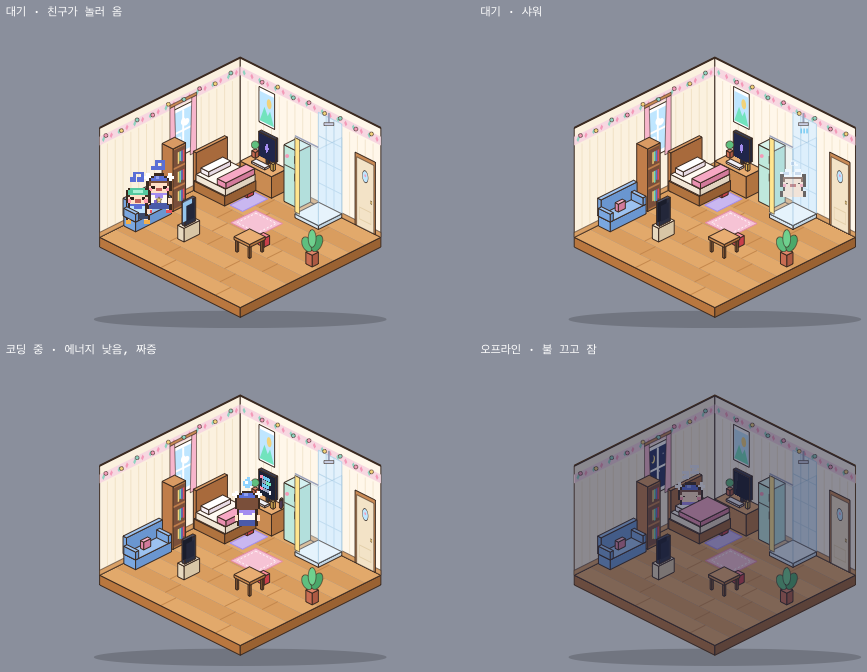
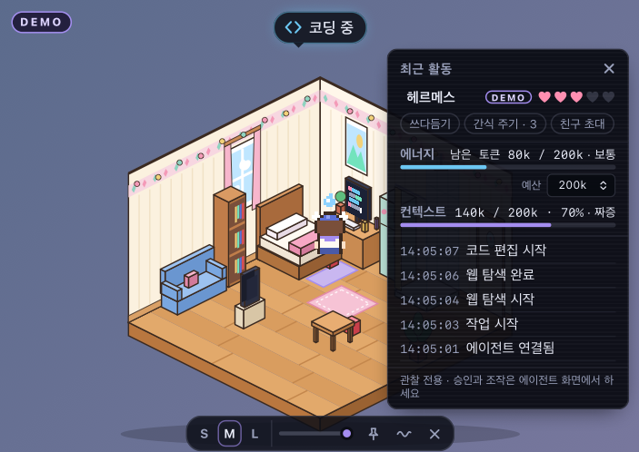
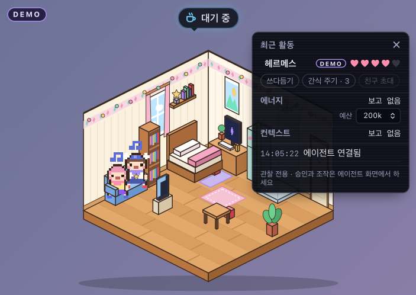

# Deskling

AI 에이전트가 실제로 일하는 모습을 바탕화면에 박힌 밝은 아이소메트릭 픽셀 미니룸 속 펫 "헤르메스"의 모습으로 보여주는 macOS 데스크톱 앱.

> **상태:** vertical slice, MVP 화면(11개 상태, 활동 패널, 창 설정), 생활감(에너지·화남), 키우기(성장·방 꾸미기·돌보기), 미니룸(헤르메스의 일상·친구 초대)이 동작한다. 아직 실제 에이전트(Hermes 등)와는 연결되지 않았고
> 결정적(deterministic) **데모 이벤트**로만 동작한다. 데모로 동작하는 동안 화면에는 항상 `DEMO` 배지가 표시된다.
> 진행 상황과 검증 기록은 [PROJECT_STATE.md](PROJECT_STATE.md)에 있다.



헤르메스의 사생활을 엿보는 미니룸. 에이전트가 쉬는 동안 헤르메스는 방 안에서 자기 일상을 살고(왼쪽 위 친구가 놀러 옴, 오른쪽 위 샤워), 일이 들어오면 책상으로 돌아온다(왼쪽 아래 코딩 중 — 빈 캔과 땀 이모트는 에너지 낮음·짜증). 연결이 끊기면 불을 끄고 잔다(오른쪽 아래).

## 무엇을 하나

- 투명하고 프레임 없는 창에 밝은 아이소메트릭 픽셀 미니룸(크림색 벽, 나무 바닥, 침대·컴퓨터 책상·샤워 부스·냉장고·식탁·TV·소파·책장·문)을 띄우고, 그 안에서 펫 헤르메스가 걸어 다닌다.
- 에이전트 이벤트를 받아 `offline`, `idle`, `thinking`, `coding`, `browsing`, `terminal`, `file-work`,
  `waiting-approval`, `delegated`, `success`, `error` 상태를 헤르메스의 행동·이모트·모니터 화면·말풍선 텍스트로 보여준다.
  - 작업 상태(생각·코딩·웹 탐색·터미널·파일 작업·오류)에서는 컴퓨터 책상으로 간다.
  - 승인 대기면 방 앞으로 나와 손을 흔든다. 위임되면 친구가 와서 옆자리 노트북 앞에서 돕는다.
  - 오프라인이면 방 불이 꺼지고 침대에서 잔다.
- **대기 중에는 자기 일상:** 샤워, 밥, TV, 책, 창밖 보기, 스트레칭, 화분 물주기, 낮잠, 친구 초대. 이것은 펫의 생활이지 에이전트에 대한 정보가 아니며, 대기 중에는 컴퓨터를 쓰지 않는다.
  활동 패널의 "친구 초대" 버튼으로 친구를 부를 수도 있다.
- **에너지 = 남은 토큰:** 정한 예산(기본 200k) 대비 남은 토큰이 줄면 책상에 빈 에너지 캔이 쌓이고, 걸음이 느려지고, 바닥나면 배터리 이모트가 뜬다.
- **화남 = 컨텍스트:** 컨텍스트 창이 찰수록 머리 위 이모트가 땀 → 핏줄 → 김으로 바뀐다.
- **바탕화면에서 키우기:** 에이전트가 작업을 하나 끝낼 때마다 경험치가 쌓여 아기 → 어린이 → 어른으로 자라고, 방에 포스터·화분·줄 조명·러그·책·트로피가 하나씩 생긴다.
  패널에서 이름을 지어 주고 쓰다듬거나 간식을 주면 하트가 떠오르고 애정도가 오른다(에이전트에는 아무 영향 없음). 데모로 자란 펫은 실제 에이전트 펫과 따로 저장된다.
- 장면에는 숫자를 그리지 않는다. 캐릭터를 클릭하면 열리는 활동 패널에 남은 토큰·컨텍스트 숫자와 최근 활동이 나온다.
- 창은 기본적으로 바탕화면 위, 다른 창 아래에 박혀 있고 Dock·⌘Tab에 나타나지 않는다. 툴바의 "위에 띄우기"로 항상 위 표시를 켤 수 있다. 드래그 이동, 크기·투명도 조절, reduced-motion(걷기 대신 순간 이동)을 지원한다. 기본 창 크기는 480×340.

### 11개 상태

상태마다 헤르메스의 행동·이모트·말풍선 텍스트·모니터 화면이 다르다.
데모 시나리오는 활동 패널에서 고른다: **전체 상태**(11개 상태 순서대로), **기본 흐름**(`idle → thinking → coding → terminal → success → idle`), **하루 일과**(대기 일상 → 일 → 지치고 화남 → 다시 쉼 → 잠).


(그림은 실제 `MiniRoom` 마크업을 WebKit으로 렌더링한 것. 대기 칸의 일상은 그중 하나인 책 읽기.)

### 활동 패널과 창 설정

캐릭터를 클릭하면 활동 패널(에너지·컨텍스트 숫자, 토큰 예산, 최근 활동)이, 마우스를 올리면 창 설정 툴바(크기 S/M/L, 불투명도, 위에 띄우기, 모션, 닫기)가 나타난다.



### 키우기와 친구 초대



패널 맨 위 펫 영역에서 이름을 짓고 쓰다듬기·간식으로 애정도(하트)를 올리고, "친구 초대"로 친구를 부른다. 친구가 와 있거나 오프라인이면 초대 버튼이 비활성이다.

## 하지 않는 것

- 에이전트에게 명령을 보내거나 권한을 승인하지 않는다. **관찰만 한다.**
- chain-of-thought, 프롬프트, 파일 내용·경로, 터미널 명령어, 환경변수, API 키, 헤더, tool arguments를 표시하거나 저장하지 않는다.
- 진행률이나 작업 내용을 추측하지 않는다. 화면은 실제 도착한 이벤트만 반영한다.

## 요구 사항

- macOS (Apple Silicon에서 개발·검증)
- Node.js 20.19+ 또는 22.12+ (개발 환경: 23.11)
- Rust stable (개발 환경: 1.100) — `rustup`으로 설치
- Xcode Command Line Tools

`cargo`가 셸 PATH에 없어도 npm 스크립트가 `~/.cargo/bin`을 자동으로 추가한다.
터미널에서 직접 `cargo`를 쓰려면 `~/.zshrc`에 `. "$HOME/.cargo/env"`를 추가한다.

## 시작하기

```bash
npm install
npm run tauri dev      # 네이티브 오버레이 창 실행
```

## 명령

| 명령 | 설명 |
| --- | --- |
| `npm run test` | 테스트 실행 |
| `npm run typecheck` | 타입 검사 |
| `npm run lint` | 린트 |
| `npm run build` | 프런트엔드 프로덕션 빌드 |
| `npm run verify:fast` | typecheck + lint + test |
| `npm run verify` | verify:fast + build + Rust fmt/clippy/test |
| `npm run tauri dev` | 개발 모드로 앱 실행 |
| `npm run build:app` | macOS 앱 번들 빌드 → `src-tauri/target/release/bundle/macos/Deskling.app` |

## 구조

```
src/core/       이벤트 규격·정규화·리듀서 (순수 TS)
src/adapters/   이벤트 소스 (demo; 향후 Hermes)
src/platform/   Tauri 창 API 래퍼
src/app/        조립·설정
src/ui/         미니룸 장면과 패널 컴포넌트
src-tauri/      Tauri 2 / Rust 셸
docs/           제품·요구사항·설계·테스트 문서
```

## 문서

- [AGENTS.md](AGENTS.md) — 작업 규칙
- [docs/PRODUCT.md](docs/PRODUCT.md) — 제품 정의
- [docs/REQUIREMENTS.md](docs/REQUIREMENTS.md) — 요구사항
- [docs/ARCHITECTURE.md](docs/ARCHITECTURE.md) — 아키텍처
- [docs/EVENT_PROTOCOL.md](docs/EVENT_PROTOCOL.md) — AgentEvent 규격
- [docs/DESIGN.md](docs/DESIGN.md) — 시각 디자인
- [docs/TEST_PLAN.md](docs/TEST_PLAN.md) — 테스트 계획
- [docs/TASKS.md](docs/TASKS.md) — 작업 체크리스트
- [docs/ACCEPTANCE.md](docs/ACCEPTANCE.md) — 인수 기준
- [PROJECT_STATE.md](PROJECT_STATE.md) — 현재 상태
- [DECISIONS.md](DECISIONS.md) — 설계 결정 기록
